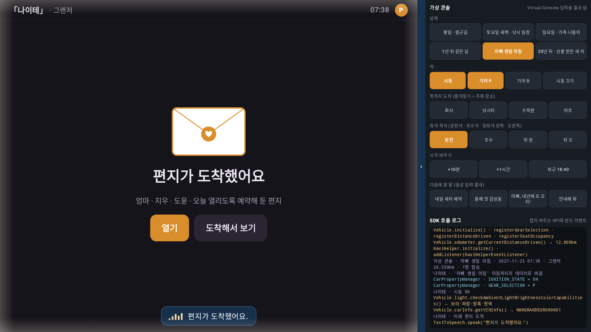
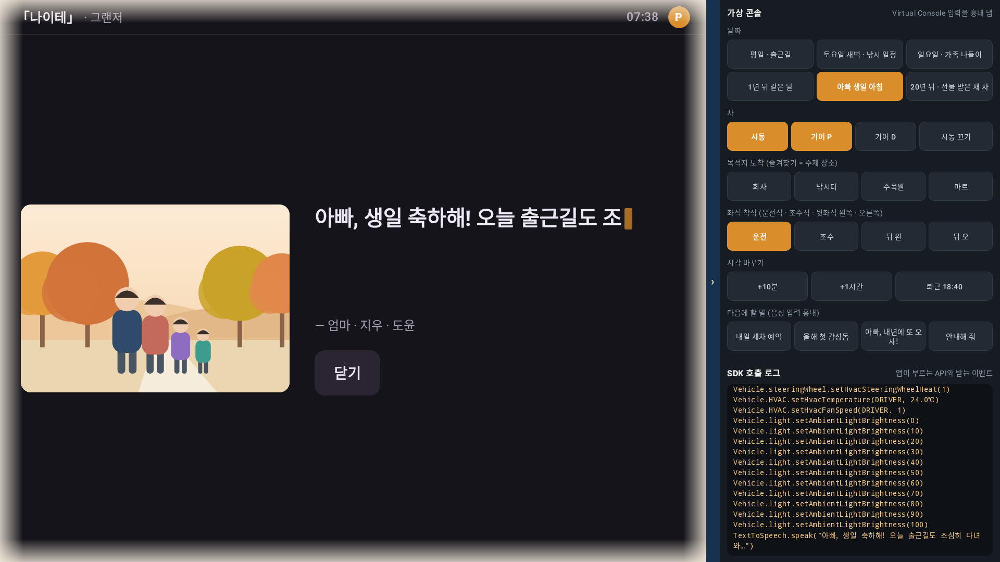
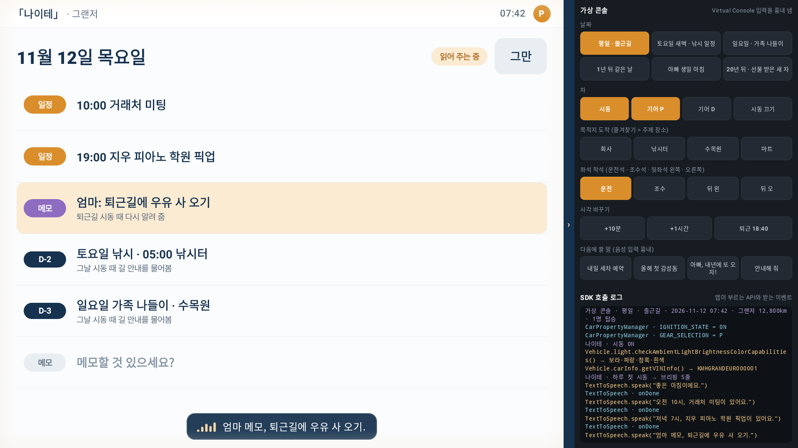
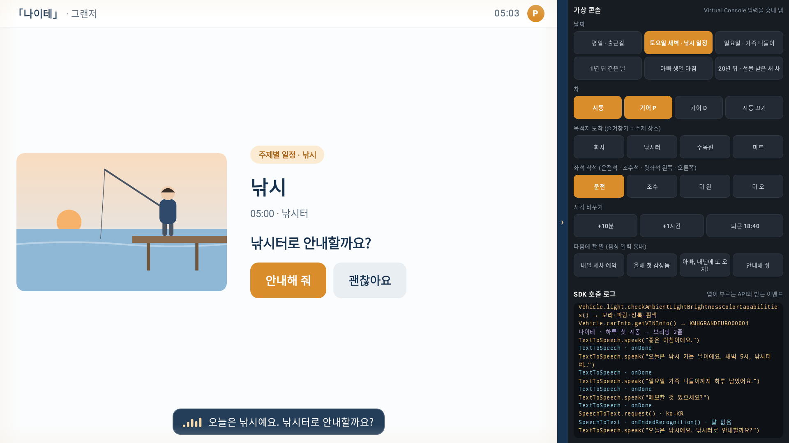
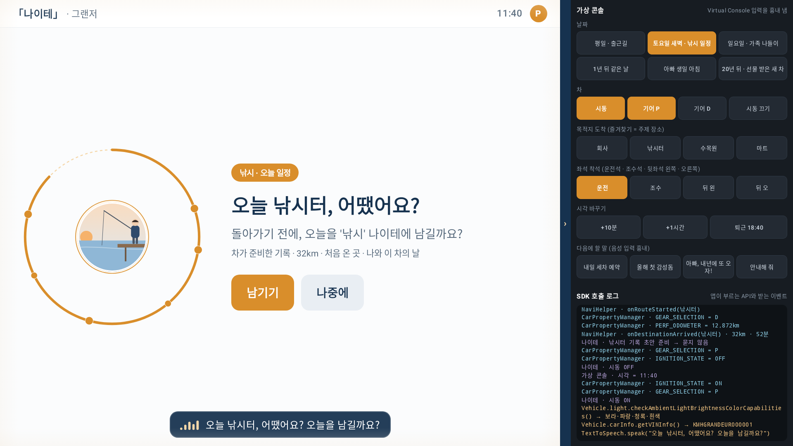
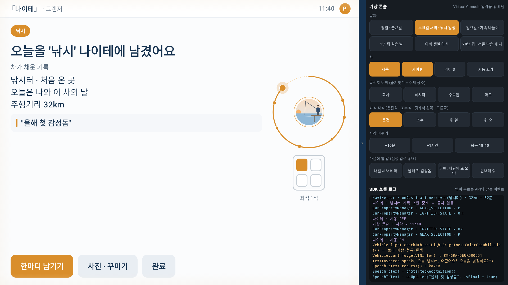
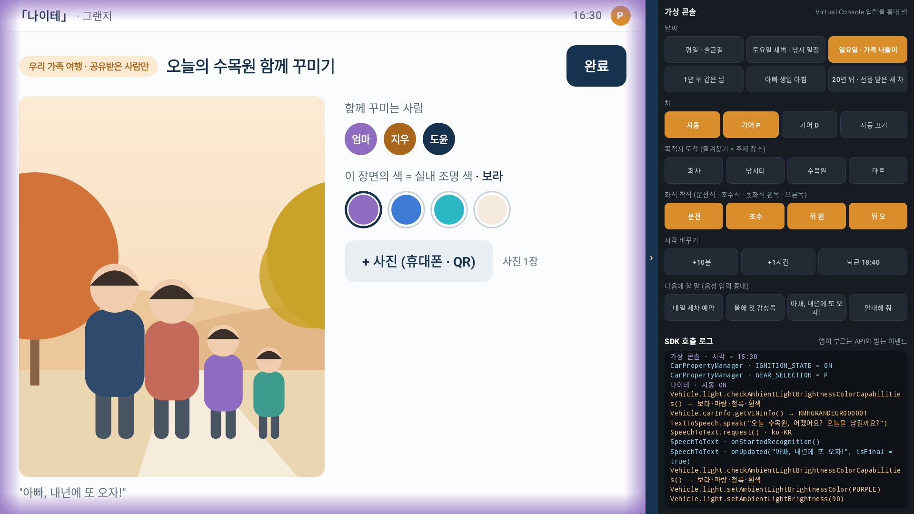
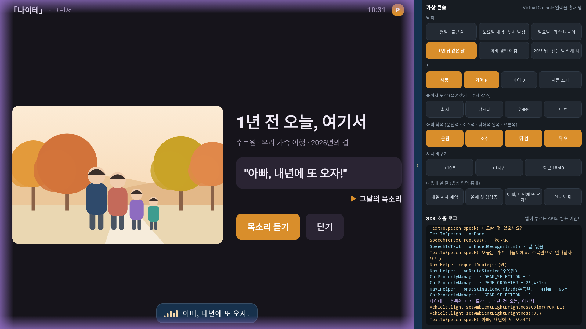
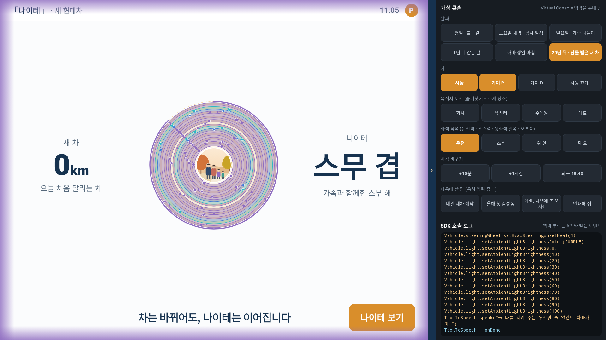
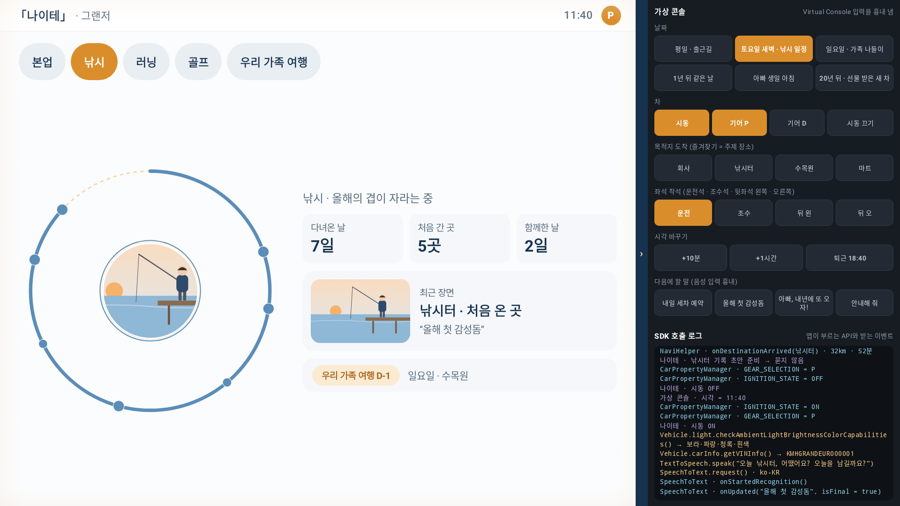

# 나이테

> 출근길엔 오늘의 일정을 목소리로 챙기고, 그 일정으로 다녀온 날은 추억의 나이테로 새겨 다음 현대차까지 이어 주는 Pleos Connect 일정·추억 앱

현대자동차그룹 차량용 앱 개발 공모전 출품작 「나이테」의 Android 프로토타입이다. 패키지는 `com.naitae.connect`, 버전은 0.1.0 이다. 앱에 들어 있는 사람·일정·기록은 모두 가상 페르소나 데이터이며 실제 인물이 아니다.

## 차에서 일어나는 일

| 동사 | 기능 | 차에서 일어나는 일 |
|---|---|---|
| 챙긴다 | 일정·메모 브리핑 | 하루 첫 시동(기어 P)에 오늘 일정, 메모, 7일 안의 주제별 일정 D-day 를 음성으로 읽는다. 끝에 "메모할 것 있으세요?"라고 묻고 말로 메모를 받는다. 일정에 장소가 있으면 "낚시터로 안내할까요?"라고 묻고, 화면의 "안내해 줘"를 누를 때만 길 안내를 요청한다. 퇴근길(17시 이후) 시동에는 정해 둔 메모를 다시 읽는다 |
| 남긴다 | 특별한 날 기록 · 함께 꾸미기 | 도착할 때는 묻지 않는다. 그곳에서 시간을 보낸 뒤 다시 시동을 걸면 "오늘을 남길까요?"라고 묻는다. 주행거리, 처음 간 곳, 좌석 수는 차가 채우고 사람은 한마디(음성), 사진, 색만 더한다. 고른 색은 실내 조명 색으로 설정한다 |
| 돌아본다 | 차에서 다시 보기 | 예전 기록이 있는 곳에 다시 도착하면 "1년 전 오늘, 여기서"가 열린다. 실내 조명을 그날의 색으로 바꾸고 그날의 한마디를 들려준다 |
| 건넨다 | 미래 편지 | 정한 날 시동을 걸면 "편지가 도착했어요"가 열린다. 열면 시트·핸들 열선과 공조를 켜고 실내 조명을 단계적으로 밝힌 뒤 편지를 읽는다. 닫거나 출발하면 실내 조명만 원래대로 되돌린다 |
| 이어진다 | 이어받기 | 차대번호(VIN)가 계정에 등록된 차와 다르면 나이테·일정·메모를 그대로 이어받고 "새 차 0km · 나이테 스무 겹"을 보여 준다 |

공통 규칙은 세 가지다. 평소 도착에는 화면을 띄우지 않는다. 기어가 P 가 아니면 화면 입력을 받지 않고 낭독과 연출을 멈춘다. 좌석은 착석 수만 쓰고 누가 탔는지는 저장하지 않는다.

## 화면

시뮬레이터 모드의 화면이다. 왼쪽이 차량 화면이고 오른쪽 패널이 앱에 들어 있는 가상 콘솔과 SDK 호출 로그다. 전체 캡처는 [`docs/screenshots/`](docs/screenshots/) 에 `NN_<날짜>_<화면>.png` 이름으로 있다.

| 편지 도착: 편지가 열리는 날의 시동 | 편지 낭독: 온기와 조명 연출 뒤 |
|---|---|
|  |  |

| 브리핑: 하루 첫 시동 | 길 안내 질문: 오늘 일정에 장소가 있을 때 |
|---|---|
|  |  |

| 오늘을 남길까요?: 다녀온 곳에서 다시 시동을 걸었을 때 | 남긴 기록: 차가 채운 정보와 한마디 |
|---|---|
|  |  |

| 함께 꾸미기: 고른 색이 실내 조명 색 | 차에서 다시 보기: 예전 기록이 있는 곳에 도착했을 때 |
|---|---|
|  |  |

| 이어받기: VIN 이 다른 차의 첫 시동 | 홈: 주제별 나이테 |
|---|---|
|  |  |

## Pleos Connect SDK 활용 요약

`vehicle/pleos/` 의 어댑터가 실제로 부르는 API 만 적었다. 파일별 호출 위치와 실패 처리는 [`docs/SDK_USAGE.md`](docs/SDK_USAGE.md) 에 있다.

| 기능 | SDK | 어댑터가 부르는 API | 권한 (`pleos.car.permission.`) |
|---|---|---|---|
| 기어 P 판단, 주행 중 잠금 | Vehicle 2.3.2 | `Gear.getCurrentGearSelectionState`, `registerGearSelection` | `CAR_DRIVE` |
| 이번 이동 거리 | Vehicle | `Odometer.getCurrentDistanceDriven`, `registerDistanceDriven` | `CAR_DRIVE` |
| 좌석 수(함께한 날 여부) | Vehicle | `Seat.checkSeatOccupancyCapabilities`, `getCurrentSeatOccupancy`, `registerSeatOccupancy` | `CAR_SEATS` |
| 새 차 이어받기 | Vehicle | `CarInfo.getVINInfo` | `CAR_INFO` |
| 기록의 색, 다시 보기, 편지의 실내 조명 | Vehicle | `Light.checkAmbientLight{BrightnessColor,Brightness,Switch}Capabilities`, `setAmbientLightSwitch`, `setAmbientLightBrightnessColor`, `setAmbientLightBrightness`, `getAmbientLightBrightness`, `getAmbientLightBrightnessColor` | `CAR_LIGHTS`, `CONTROL_CAR_LIGHTS` |
| 편지의 시트 열선 | Vehicle | `Seat.checkSeatTemperatureCapabilities`, `setHvacSeatTemperature`, `getHvacSeatTemperature` | `CAR_SEATS`, `CONTROL_CAR_SEATS` |
| 편지의 핸들 열선 | Vehicle | `SteeringWheel.checkHvacSteeringWheelHeatCapabilities`, `setHvacSteeringWheelHeat`, `getHvacSteeringWheelHeatState` | `CAR_CLIMATE`, `CONTROL_CAR_CLIMATE` |
| 편지의 온도·풍량 | Vehicle | `HVAC.checkHvac{Temperature,FanSpeed,Power}Capabilities`, `getHvacPowerState`, `setHvacPower`, `setHvacTemperature`, `setHvacFanSpeed`, `getHvacTemperature`, `getHvacFanSpeed` | `CAR_CLIMATE`, `CONTROL_CAR_CLIMATE` |
| 길 안내 요청, 도착 감지 | NaviHelper 3.0.5 | `initialize`, `addListener`, `requestRoute(RouteInfo)`, `getDestinationInfo`, 이벤트 `onRouteStarted` · `onRoutingCompleted` · `onRouteCancelled` · `onDestinationInfo` · `onDestinationArrived` · `onError` | `NAVI_ROUTE`, `NAVI_ROUTE_SEARCH` |
| 브리핑·메모·편지 낭독 | TextToSpeech 3.3.1 | `TextToSpeech(context, Mode.ON_DEVICE)`, `initialize`, `setLocale(Locale.KOREA)`, `addEventListener`, `speak`, `stop` | `TTS_SERVICE` |
| 말로 메모·한마디 받기 | SpeechToText 3.3.1 | `SpeechToText(context, Mode.ON_DEVICE)`, `initialize`, `setLocale(Locale.KOREA)`, `addListener`, `request`, `stop` | `STT_SERVICE` |
| 장소를 붙인 메모의 근접 알림 | FusedLocation 1.1.3 | `isSupported`, `initialize`, `addProximityAlert(ProximityAlertRequest)`, `removeProximityAlert`. 장소를 붙인 메모가 계정에 있을 때 등록한다(가상 데이터에는 없다) | `FUSED_LOCATION` (실행 중 허용) |

## 실행 방법

### 1. 빌드

필요한 것은 JDK 17 이상(개발에는 21 을 썼다)과 Android SDK Platform 34 다. SDK 위치는 `ANDROID_HOME` 환경 변수나 `local.properties` 의 `sdk.dir` 로 알려 준다. Pleos Connect SDK 는 Pleos 공개 Maven 저장소에서 인증 없이 내려받으므로 네트워크가 필요하다.

```bash
./gradlew :app:assembleDebug      # app/build/outputs/apk/debug/app-debug.apk
./gradlew :app:assembleRelease    # app/build/outputs/apk/release/app-release.apk
```

Windows 에서는 `gradlew.bat` 을 쓴다. release 빌드는 바로 설치할 수 있도록 디버그 키로 서명한다.

### 2. Pleos Connect Emulator 에서 실행

1. Android Studio 의 SDK Update Site 에 `https://nexus-playground.pleos.ai/repository/raw-releases/connect-avd/2.x/crp-sys-img.xml`(Mac 은 `crp-arm64-sys-img.xml`)을 추가하고, Automotive 폼 팩터의 `Pleos Connect v2.1.0`(API 34) AVD 를 만든다. 부팅 방식은 Cold boot 로 둔다(Quick boot 에서는 차량 신호를 쓸 수 없다).
2. APK 를 설치하고 실행한다.

   ```bash
   adb install -r app/build/outputs/apk/release/app-release.apk
   adb shell am start -n com.naitae.connect/.app.MainActivity
   ```

3. Virtual Console 을 연다.

   ```bash
   adb forward tcp:8088 tcp:8088
   ```

   PC 브라우저에서 `http://127.0.0.1:8088/` 을 연다.

앱은 Pleos Vehicle 서비스를 찾으면 Pleos 모드로 실행된다. 이 모드에서는 앱이 차량 서비스에 연결되어 기어 값을 처음 받은 때를 시동 ON 으로 보고, 날짜는 기기 시계를 쓴다. 가상 데이터는 첫 실행 날짜를 기준으로 만든다. 차량에서 VIN 을 읽으면 가상 데이터의 차와 달라 첫 실행에 이어받기 화면이 먼저 열린다.

| Virtual Console 카드 | 앱이 받거나 설정하는 API | 앱 동작 |
|---|---|---|
| Gear Selection (P/R/N/D) | `GearSelectionListener.onSelected` | P 에서 시동 흐름과 화면 조작을 허용한다. P 가 아니면 낭독·연출을 멈추고 터치를 잠근다 |
| Odometer | `DistanceDrivenListener.onDistanceDrivenUpdated` | 이번 이동 거리 계산, 이어받기 화면의 새 차 주행거리 |
| Seat Occupancy (동승석 · 뒷좌석 좌우) | `SeatOccupancyListener.onSeatOccupancyUpdated` | 기록의 좌석 수, 새 차 첫 시동의 편지를 바로 열지 먼저 물을지 |
| Ambient Color · Ambient Brightness | `Light.setAmbientLightBrightnessColor`, `setAmbientLightBrightness` | 함께 꾸미기에서 고른 색, 다시 보기, 편지 연출의 값이 카드에 나타난다 |
| Seat Temperature · Steering Wheel Heat · Target Temperature · Fan Speed | `Seat.setHvacSeatTemperature`, `SteeringWheel.setHvacSteeringWheelHeat`, `HVAC.setHvacTemperature`, `setHvacFanSpeed` | 미래 편지 연출의 값이 카드에 나타난다 |

Virtual Console 에는 내비게이션 도착, 위치, 차량 속도, VIN 카드가 없다. 도착이 필요한 장면(남기기, 다시 보기)과 날짜가 정해진 장면은 3번의 시뮬레이터 모드에서 재현한다.

### 3. 일반 Android 기기·에뮬레이터에서 실행 (시뮬레이터 모드)

Android 9(API 28) 이상이면 같은 APK 를 그대로 설치한다. 앱은 Pleos Vehicle 서비스가 없는 것을 확인하면 시뮬레이터 모드로 시작하고, 화면 오른쪽에 가상 콘솔을 붙인다. 가상 콘솔에서 날짜 6개, 시동, 기어, 목적지 도착, 좌석, 시각, 다음에 할 말을 넣고, 아래 "SDK 호출 로그"에서 앱이 부르는 API 와 받는 이벤트를 본다. 화면은 가로로 고정된다.

여섯 날의 시연 순서는 [`docs/DEMO_GUIDE.md`](docs/DEMO_GUIDE.md) 에 있다.

## 테스트 환경 및 필요한 설정

| 항목 | 값 |
|---|---|
| 언어 · 빌드 | Kotlin 1.9.25, Android Gradle Plugin 8.5.2, Gradle 8.9(wrapper), JDK 17 이상 |
| Android | compileSdk 34, targetSdk 34, minSdk 28 |
| 화면 | Jetpack Compose (BOM 2024.06.00, 컴파일러 확장 1.5.15), Material3 |
| 그 밖의 라이브러리 | kotlinx-coroutines 1.8.1, kotlinx-serialization-json 1.6.3 |
| Pleos Connect SDK | `ai.pleos.playground:Vehicle:2.3.2`, `NaviHelper:3.0.5`, `TextToSpeech:3.3.1`, `SpeechToText:3.3.1`, `FusedLocation:1.1.3` |
| SDK 저장소 | `https://nexus-playground.pleos.ai/repository/maven-releases/` (`settings.gradle.kts`) |
| 대상 에뮬레이터 | Pleos Connect Emulator v2.1.0 (API 34, Cold boot) |

### 선언한 권한

| 권한 | 쓰는 곳 |
|---|---|
| `pleos.car.permission.CAR_DRIVE` | 기어, 누적 주행거리 읽기 |
| `pleos.car.permission.CAR_INFO` | VIN 읽기(이어받기) |
| `pleos.car.permission.CAR_SEATS` · `CONTROL_CAR_SEATS` | 좌석 착석 여부와 시트 열선 범위 읽기 · 운전석 시트 열선 켜기 |
| `pleos.car.permission.CAR_LIGHTS` · `CONTROL_CAR_LIGHTS` | 실내 조명 지원 영역·범위·현재 값 읽기 · 색과 밝기 바꾸기 |
| `pleos.car.permission.CAR_CLIMATE` · `CONTROL_CAR_CLIMATE` | 공조·핸들 열선 범위 읽기 · 온도, 풍량, 전원, 핸들 열선 바꾸기 |
| `pleos.car.permission.NAVI_ROUTE` · `NAVI_ROUTE_SEARCH` | 목적지·즐겨찾기 조회 · 길 안내 요청 |
| `pleos.car.permission.TTS_SERVICE` · `STT_SERVICE` | 낭독 · 음성 입력 |
| `pleos.car.permission.FUSED_LOCATION` | 장소 메모의 근접 알림 |
| `android.permission.FOREGROUND_SERVICE` · `FOREGROUND_SERVICE_SPECIAL_USE` · `POST_NOTIFICATIONS` | 차량 신호 구독을 유지하는 포그라운드 서비스와 그 알림(Pleos 모드에서만 시작) |

`android.hardware.type.automotive` 는 `required="false"` 로 덮어써서 일반 기기에도 설치된다. 로터리 조작은 지원하지 않는다고 선언했고(`com.hmg.rotary.ROTARY_SUPPORTED=false`), 액티비티에는 `distractionOptimized` 를 선언했다.

### 실행 중 권한 요청

- Pleos 모드: 첫 실행에 `pleos.car.permission.FUSED_LOCATION` 과 알림 권한을 묻는다. 허용하지 않아도 앱은 실행되고 근접 알림만 등록되지 않는다.
- 시뮬레이터 모드: 묻는 권한이 없다.

### 녹음 음성 자산 (선택)

다시 보기의 한마디와 편지는 녹음 파일이 있으면 그 파일을 재생하고, 없으면 TTS 로 읽는다. 저장소에는 녹음 파일이 들어 있지 않으므로 기본 동작은 TTS 낭독이다. 녹음을 쓰려면 아래 경로에 파일을 넣고 다시 빌드한다.

| 경로 (`app/src/main/assets/` 아래) | 쓰이는 곳 |
|---|---|
| `voice/jiwoo_last_year.mp3` | 1년 뒤 다시 보기의 한마디 |
| `voice/birthday_letter.mp3` | 생일 편지 |
| `voice/umbrella_letter.mp3` | 새 차 첫 시동의 편지 |

## APK 위치

제출용 APK 는 `apk/<팀명>_나이테_release.apk` 에 둔다. `<팀명>` 은 제출 전에 실제 팀명으로 바꿔야 하는 자리 표시다. `./gradlew :app:assembleRelease` 로 만든 `app/build/outputs/apk/release/app-release.apk` 를 이 이름으로 복사한다.

## 프로젝트 구조

```
app/src/main/java/com/naitae/connect
├─ core/model   데이터 모델(주제, 일정, 메모, 기록, 편지, 차)
├─ vehicle      차량 연결 인터페이스, SDK 호출 로그
│  ├─ pleos     Pleos Connect SDK 어댑터(Vehicle, NaviHelper, TTS, STT, FusedLocation)
│  └─ sim       시뮬레이터와 가상 콘솔의 차
├─ data         JSON 파일 저장소, 가상 페르소나 데이터
├─ domain       브리핑, 메모, 이동 추적, 기록, 다시 보기, 편지, 이어받기, 나이테 계산
├─ ui           화면 상태 계약, 화면, 가상 콘솔 패널
└─ app          조립, 상태 기계(코디네이터), 차량 신호 서비스, 녹음 재생
docs            구조, 플랫폼 조사 노트, SDK 시그니처, 시연 가이드, SDK 활용
```

## 테스트

```bash
./gradlew :app:testDebugUnitTest
```

기기나 에뮬레이터 없이 JVM 에서 두 가지를 실행한다.

- 단위 테스트: 도메인 엔진(브리핑, 메모, 이동 추적, 기록, 다시 보기, 편지 연출, 이어받기, 나이테), JSON 저장소, 가상 데이터
- 시나리오 테스트(`app/src/test/java/com/naitae/connect/e2e/`): 실제 앱 클래스를 시뮬레이터 플랫폼으로 띄워 여섯 날을 순서대로 진행하고, 화면 캡처를 `docs/screenshots/` 에 다시 만든다

## 검증 상태

| 대상 | 상태 |
|---|---|
| 빌드 | 실제 Pleos Connect SDK 아티팩트(위 버전)를 의존성으로 두고 빌드한다 |
| 도메인 로직 | JVM 단위 테스트로 확인한다 |
| 여섯 날의 시나리오 | 시뮬레이터 플랫폼에서 화면 장치 없이 처음부터 끝까지 실행해 확인한다. 방법과 결과는 [`docs/VERIFICATION.md`](docs/VERIFICATION.md) 에 있다 |
| Pleos 어댑터(`vehicle/pleos/`) | Pleos 에뮬레이터와 실차에서 실행해 확인하지 않았다. SDK AAR 에서 추출한 시그니처는 [`docs/pleos-sdk-api/`](docs/pleos-sdk-api/) 에 있다 |

## 데이터와 개인정보

- 좌석은 착석 수만 읽고 기록한다. 누가 앉았는지는 읽지도 저장하지도 않는다. 차에서 말로 남긴 한마디에도 말한 사람을 저장하지 않는다.
- 계정 원본은 서버 대신 앱 내부 저장소의 JSON 파일(`files/naitae.json`)로 대신한다. 앱 백업은 꺼 두었다(`allowBackup="false"`).
- 앱 코드에는 네트워크 호출이 없다. 음성은 차 안 엔진(`Mode.ON_DEVICE`)만 쓴다.
- Pleos 모드의 SDK 호출 로그에는 VIN 을 앞 3자리와 끝 4자리만 남긴다.
- 사진은 실제 사진 대신 주제의 장면 그림으로 대신한다. 카메라와 저장소 권한을 쓰지 않는다.
- 사람·일정·기록·편지는 모두 가상 페르소나 데이터다.

## 문서

- [`docs/DEMO_GUIDE.md`](docs/DEMO_GUIDE.md): 여섯 날의 시연 순서
- [`docs/SDK_USAGE.md`](docs/SDK_USAGE.md): SDK 별 호출 위치, 권한, 실패 처리, 플랫폼에 제안하는 API
- [`docs/VERIFICATION.md`](docs/VERIFICATION.md): 검증 방법과 결과
- [`docs/ARCHITECTURE.md`](docs/ARCHITECTURE.md): 구조와 상태 흐름
- [`docs/PLEOS_NOTES.md`](docs/PLEOS_NOTES.md): Pleos Connect 플랫폼 조사 노트
